# Motif on Qt

Compile old Motif programs, unmodified, against Qt 6. No X server, no libXm
and no libXt are needed at run time: the Xt/Motif C API, and the part of Xlib
Motif programs use, are implemented on Qt widgets. Programs run on any Qt
platform: Wayland, X11, Windows or macOS, or headless with `offscreen`.

| Motif 2.3.8 on X11 | the same source on Qt 6 |
| --- | --- |
| 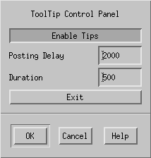 | 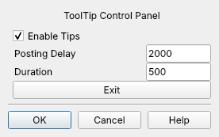 |
| 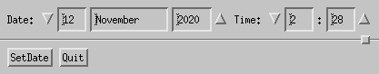 | 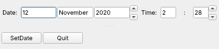 |
| 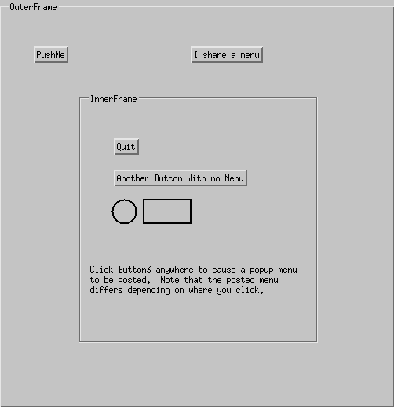 | 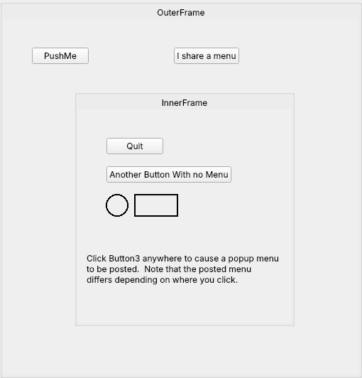 |

The programs are Motif's own demos (`demos/programs` in the Motif 2.3.8
sources), copied into `examples/` without changes.

## A real application: xpdf

xpdf 3.04, the last Motif version of the PDF viewer (as Debian maintains it,
rendering through poppler), builds from its unmodified sources with
`tools/build-xpdf.sh` and runs on Qt, here on an X11 display:

| xpdf with real Motif 2.3.8 | the same source on Motif on Qt |
| --- | --- |
| 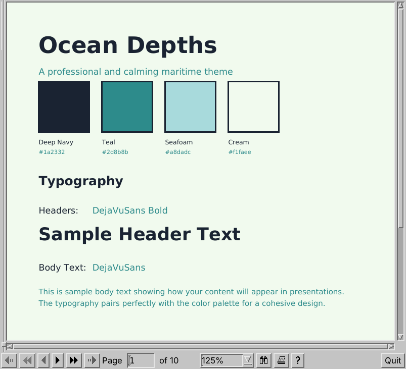 | 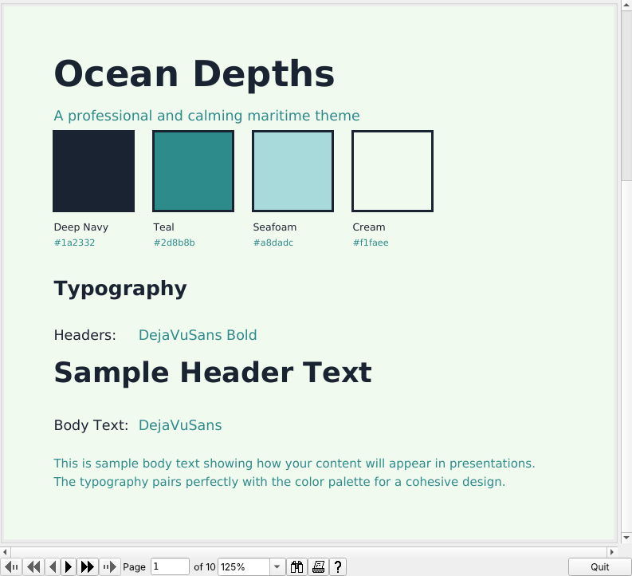 |

Page navigation (toolbar, keys, page number entry), zoom, text search, the
right-click menu with its accelerators, the Open dialog (a
FileSelectionBox) and the About and Find dialogs work:

| Open | Find | menu |
| --- | --- | --- |
| 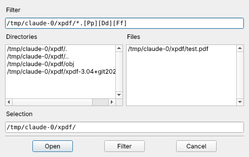 | 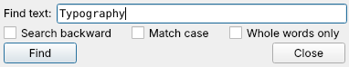 | 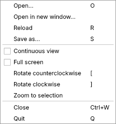 |

The outline pane is configured out (`DISABLE_OUTLINE`, an xpdf build
option): it is a widget class of xpdf's own, see *Not supported*.

## How it works

* **The genuine headers.** `include/` holds the real public X11, Xt and
  Motif 2.3 headers (MIT and LGPL). Programs compile against exactly the API
  they were written for, and the implementation is type-checked against the
  same prototypes.
* **Widgets are Qt objects.** Each Motif widget owns a Qt widget (or a
  `QAction` when it lives in a menu): XmPushButton is a QPushButton, XmText
  a QPlainTextEdit or QLineEdit, a pulldown menu a QMenu. XmForm attachments,
  RowColumn packing and BulletinBoard positions are QLayouts that apply
  Motif's own geometry rules.
* **Resources behave like Motif's.** Every resource's type, size and
  default comes from Motif's own `XtResource` tables, extracted by
  `tools/gen_from_motif.py` into `src/generated/`. `XtGetValues` therefore
  writes the right number of bytes. App-defaults files, fallback resources,
  `~/.Xdefaults`, `-xrm` and the standard command-line options go through an
  Xrm database with the X precedence rules.
* **Xlib draws into images.** A widget's window is an id backed by a QImage.
  GCs, `XDrawLine`/`XFillArc`/`XCopyArea`, XOR drawing, pixmaps, bitmaps,
  XImages and fonts (XLFD names) map onto QPainter. Showing, resizing and
  `XClearArea` deliver Expose events, as an X server would.
* **Events and the main loop.** `XtAppMainLoop` runs the Qt event loop.
  Qt input becomes XEvents for event handlers, translation tables and
  actions. Timeouts, work procs and input sources map onto QTimer and
  QSocketNotifier. Programs with their own `XtAppNextEvent` loop work too.

## Building

Requires CMake and Qt 6 (Widgets).

```bash
cmake -B build
```

```bash
cmake --build build
```

```bash
ctest --test-dir build
```

`build/lib` then contains `libmotif-on-qt.so` and the link names `libXm.so`,
`libXt.so`, `libX11.so` (and `Xext`, `Xmu`, `Xpm`), all pointing at it. An
existing Motif program builds with its usual flags plus two paths:

```bash
cc -I/path/to/motif-on-qt/include prog.c -L/path/to/build/lib -Wl,-rpath,/path/to/build/lib -lXm -lXt -lX11
```

## Environment variables

* `QT_QPA_PLATFORM=offscreen` runs without a display, which is useful for tests.
* `MOTIFQT_AUTOQUIT=<ms>` exits the program after that many milliseconds.
* `MOTIFQT_SCREENSHOT=<file.png>` saves the top-level windows just before
  the autoquit exit.
* `MOTIFQT_DUMP=1` prints the Qt widget tree, with Motif names and classes,
  at the autoquit exit.
* `MOTIFQT_SCRIPT="wait 500; key n; click quit"` drives a program
  headlessly. The steps are `wait <ms>`, `key [<widget>] <keys>`,
  `click <widget> [button]`, `type <widget> <text>`, `shot <file.png>`,
  `dump` and `quit`, where `<widget>` is a Motif widget name.

## Running on X11

On an X11 desktop, Qt itself (its xcb platform, and libGL) calls the
system's libX11 with real displays, and those calls can bind to this
library's Xlib functions. Every Xlib entry point therefore forwards calls for
displays that are not its own to the next definition (the system libX11), and
`XOpenDisplay` does the same for callers that do not link against Motif on
Qt. Motif programs keep using the Qt-based implementation.

## What is implemented

* **Xt:** widget creation, management and destruction; popups; callbacks;
  `XtSetValues`/`XtGetValues` including the varargs forms and
  `XtVaTypedArg`; resource conversion from strings; application and
  subresources; the Xrm database; event handlers; translations and actions;
  accelerators in menus; timeouts, work procs and inputs; WM protocols.
* **Motif widgets:**
  * Primitives: Label, PushButton, ToggleButton, CascadeButton,
    ArrowButton, Separator, DrawnButton, and their gadgets.
  * Managers: BulletinBoard, Form, RowColumn (work area, radio box, menu
    bar, pulldown, popup and option menus, simple menus), Frame,
    DrawingArea, ScrolledWindow, MainWindow, PanedWindow.
  * Text and values: Text, TextField (with modify-verify callbacks), List,
    Scale, ScrollBar, ComboBox, SpinBox, SimpleSpinBox.
  * Dialogs: MessageBox, SelectionBox, FileSelectionBox, Command, and all
    the `XmCreate*Dialog` functions.
* **Motif utilities:** XmString (components, contexts, parse tables), font
  lists and render tables, tab lists, pixmaps and the image cache,
  `XmGetColors`, traversal, the clipboard, unit conversion, tool tips.
* **Xlib:** display and screen queries, windows, atoms and properties,
  colours (X colour names, `rgb:` and `#` specs), GCs and all drawing calls,
  pixmaps, bitmaps, XImages, fonts, cursors, keysyms, `XLookupString`, and
  shaped windows.

## Not supported

* **Writing new widget classes.** Code that defines its own widget class,
  or reads widget records directly (`w->core.width`), needs Motif's
  internals. The private headers (`XmP.h`, `IntrinsicP.h`, `*P.h`) are
  shims: programs that merely include them compile, and `XtWidth`/`XtHeight`
  work, but widget structs do not exist.
* **UIL/Mrm.**
* **Drag and drop, Container, Notebook, IconGadget and the Motif 2.2+
  extension widgets (Column, DataField, Tree, TabStack, ...).**
* **Colormap tricks** that need a PseudoColor visual: the visual is always
  24-bit TrueColor.

## Licence

LGPL 2.1 or later (`LICENSE.LGPL`), like Motif. The vendored Motif headers
and the example programs are from Motif 2.3.8 (LGPL 2.1); the X11 and Xt
headers are under the MIT licence.

This repository used to hold the Qt Solutions "Qt/Motif extension", which
let Qt and real Motif share one X11 application. That code needed Motif and
an X server and was removed in favour of this approach; it is in the git
history.
